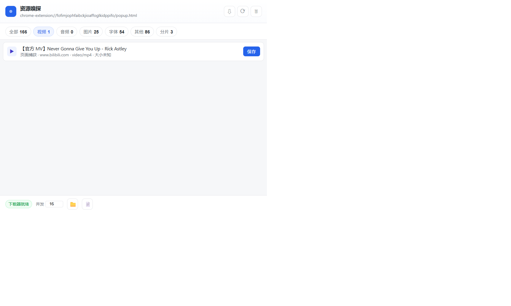

# 资源嗅探 Media Sniffer

[](https://github.com/Storete/media-sniffer/actions/workflows/tests.yml)

一个自己写的 Chrome 扩展：**自动嗅探当前网页的所有资源**，视频/音频交给本地 yt-dlp 多线程下载，图片/文档等直接抓取。没有限额、没有限速、不采集数据。



---

## 特点

| | |
|---|---|
| **8 类分组** | 视频 / 音频 / 图片 / 文档 / 字体 / 其他 / 分片，按 tab 独立归档 |
| **能抓 Blob / MSE 站点** | Telegram、以及一切把流解密后拼成 Blob 喂给 `<video>` 的站点 |
| **B 站完整视频** | 读 `__playinfo__` 的 DASH 清单，音视频分别抓完用 ffmpeg 自动合并成单文件 |
| **小红书** | 只列当前帖子自己的图（不含推荐流、头像、二维码），自动排序 |
| **不限速、不限次** | 并发 16~64 可调，断点续传 |
| **全本地** | 没有远程配置、没有埋点，数据不出机器 |

---

## 安装

### 前置要求

- Chrome / Edge / Chromium（Manifest V3）
- **Python 3.8+**（本地组件用，只依赖标准库，不需要 `pip install` 任何东西）
- **yt-dlp**（可选，没有它会退化到单线程通用下载）
- **ffmpeg**（可选，但 DASH 站点——B 站、大部分视频站——必须靠它合并音视频）

yt-dlp 和 ffmpeg 装到系统 `PATH` 就行；也可以直接把 `ffmpeg.exe` / `ffprobe.exe` 丢进项目根目录的 `bin/`（`setup.py status` 会告诉你它找到的是哪个）。

### 1. 装本地组件

```bat
双击 native-host\install.bat
```

它会做三件事：

- 生成 `host_manifest.json`（记录启动路径，**每台机器不同，所以不进仓库**）
- 生成 `python_path.txt`（记录当前解释器路径，同上）
- 注册 `HKCU\Software\Google\Chrome\NativeMessagingHosts\com.starmediasniffer.host`，顺带注册 Edge / Chromium 的同名键

> 只写当前用户注册表，不需要管理员权限。卸载跑 `uninstall.bat`。
> 想先看看状态：`python native-host\setup.py status`。

### 2. 加载扩展

1. 打开 `chrome://extensions`
2. 右上角打开 **开发者模式**
3. 点 **加载已解压的扩展程序**
4. 选这个目录：`<你放代码的地方>\media-sniffer\extension`

### 3. 核对扩展 ID

装好后 ID 必须是：

```
fofimjophfaibckjioaffoglkidppifo
```

**不是这个 ID 就用不了。** 本地组件按 `chrome-extension://<这个 ID>/` 白名单校验调用方，这是安全设计——别的扩展不能借用你的下载器。

ID 由 `extension/manifest.json` 里那段 `"key"` 决定，是公开信息，跟着仓库走。所以只要 `manifest.json` 没被改过，ID 就是稳定的，**不需要任何私钥**。

---

## 用法

1. 打开任意网页，**正常浏览**（滚一滚、点一下播放，让资源发出来）
2. 点工具栏图标 → 弹出面板
3. 顶部按类型筛选：全部 / 视频 / 音频 / 图片 / 文档 / 字体 / 其他 / 分片
4. 每条右侧：
   - **复制** → 复制直链
   - **打开** → 浏览器新标签直接打开
   - **下载** → 交给本地组件下载，面板底部显示进度
5. 右上角 **⟳** = 重新载入页面（刚装好扩展时列表是空的，这一步能抓全）

**并发数**在底部「并发」框改，默认 16，可以拉到 32~64。改完对新任务立即生效。

下载落在哪：`native-host\library.py` 会优先选一个非 C 盘的目录（Windows 上默认候选里带 `D:` 的优先），选不到才退回 `~/Downloads`。`setup.py status` 会打印实际路径。

---

## 几个站点是被特别照顾的

### B 站

普通嗅探只能抓到你已经播放过的那一小段（MSE 分片）。所以扩展在 B 站上换了做法：

- 页面里读 `window.__playinfo__` 拿到完整 **DASH 清单**（视频流 + 音频流，与播放进度无关）
- 两条流分别按 4 MB × 6 并发抓完，再用 ffmpeg `-c copy` 合并成单个 mp4（**无损，不重编码**）
- 列表里显示成一条 **「完整 DASH 流（音视频分开）」**，标题就是视频标题；多分P 会带 `-P2` 这样的后缀
- 页面右下角进度卡按「下载视频流 → 下载音频流 → 合并音视频」显示阶段，下载完可以一键「打开所在文件夹」

合并失败不算下载失败——两个源文件会保留，可以手动合：

```bat
bin\ffmpeg.exe -i video.m4s -i audio.m4s -c copy out.mp4
```

### 小红书

详情页的「推荐」「相关」「评论」里全是别的帖子的图，而它们和正文图共用同一个 CDN 签名（`1040g`），**光看 URL 区分不了**。所以改成看 DOM：排除掉带 `note-item` / `feed-item` / `recommend` 这类类名的容器，再用「父容器里图最多、面积最大」来投票认定正文容器。视频同理，列表里按顺序编号。

### Telegram / 任何 MSE 站点

见下面「为什么需要页面内 hook」。

---

## 为什么这么设计

```
┌──────────────── Chrome ────────────────┐
│  background.js (service worker)        │
│   webRequest 监听所有 http(s) 请求      │
│   → 按 mime/扩展名分类 → 按 tab 归档     │
│                                        │
│  popup.html/js                         │
│   列表 · 筛选 · 复制 · 下载按钮          │
└───────────────┬────────────────────────┘
                │ Native Messaging
                │ (4 字节长度 + JSON，走 stdin/stdout)
┌───────────────▼────────────────────────┐
│  sniffer_host.py  (宿主，随用随起)       │
│   ping → 汇报 yt-dlp / ffmpeg 是否就绪   │
│   download → 拉起独立进程后轮询状态       │
└───────────────┬────────────────────────┘
                │ detached（不随浏览器退出而死）
┌───────────────▼────────────────────────┐
│  downloader.py  (独立下载进程)           │
│   视频/音频 → yt-dlp -N 16 + ffmpeg 合并 │
│   其他资源 → urllib 单流 + 断点续传       │
│   → 状态写入 %LOCALAPPDATA%\MediaSniffer │
└────────────────────────────────────────┘
```

**关键点：下载进程是 detach 的。** 关掉弹窗、关掉浏览器、service worker 被回收，下载都不会断——重新打开扩展还在跑（`jobs` 目录里留着状态文件）。

---

## 为什么需要页面内 hook

**URL 嗅探对 Telegram 这类站点天然无效。** 它的视频不走普通 HTTP 流：

```
MTProto 分块传输 → 浏览器端解密 → 拼成完整 Blob / 喂进 MSE → <video src="blob:...">
```

网络面板里全是 `POST /apiw1` 二进制包，没有 `.m3u8`、没有 `.mp4`，`content-type` 是 `application/octet-stream`。只靠 URL 匹配的嗅探在这里同样是瞎的。

所以扩展多了一层**页面内 hook**（`inject-main.js`，跑在 MAIN world、`document_start`）：

| hook 目标 | 抓什么 |
|---|---|
| `URL.createObjectURL` | 完整视频拼成 Blob 后创建的那个 URL → 直接拿到 Blob 本体 |
| `<video>` / `<audio>` 的 `src` | **补漏**：Blob 在 Worker 里创建时主线程 hook 看不到，但 `src` 一定在主线程赋值 |
| `Element.setAttribute` + 轮询 `currentSrc` | 覆盖所有赋值方式——`currentSrc` 是浏览器解析后的最终播放源 |
| `URL.revokeObjectURL` | 页面释放 URL 时不立刻丢，**继续持有 5 分钟** |
| `MediaSource.addSourceBuffer` + `SourceBuffer.appendBuffer` | 走 MSE 流式播放的站点，按到达顺序累积分片（实验性） |

抓到后列表里显示为 **「页面视频 · mp4」**，点保存由宿主把内存里的字节直接写盘。

### 这套机制的边界

- **只对浏览器内的播放有效**。Telegram Desktop / 手机 App 不经过浏览器，抓不到。
- **Blob 有保质期**：页面 revoke 后再保留 5 分钟，过期只能重新播放一次。
- **Worker 里创建、且从不赋值给 `src` 的 Blob 抓不到**；只要它被拿去播放，就能拿到。
- **MSE 拼接是尽力而为**：随机 seek 会导致同一分片被 append 多次，拼出来可能花屏。能播，但别指望 100%。
- 内存代价：每捕获一个大视频，浏览器会多占一份引用直到 5 分钟到期。

---

## 能力对照

| | 这个扩展 | CocoCut 免费版 |
|---|---|---|
| 嗅探范围 | 所有 http(s) 资源 + 页面内 Blob/MSE，8 类分组 | 主要媒体流 |
| Telegram 类站点 | ✅ 页面内 hook 抓 Blob | ❌ 抓不到 |
| B 站完整视频 | ✅ DASH + ffmpeg 合并 | ✅ |
| 下载并发 | 16~64 可调 | 超配额后 1 |
| 限速 | 无 | 约 110 KB/s |
| 配额 | 无 | 30 次 |
| 自动带 Cookie | ✅ 用 `chrome.cookies` 取当前站点 | ✅ |
| 断点续传 | ✅ | ✅ |
| 直播录制 | ⚠️ 只能从启动那刻起 | ✅ |
| DRM 内容 | ❌ 不支持 | ❌ 也不支持 |
| 数据外传 | 无（全本地） | 有远程配置/统计 |

---

## 排错

**扩展提示「未安装本地下载器」**

1. 跑 `python native-host\setup.py status`，看注册表写没写进去、路径对不对
2. 确认扩展 ID 是 `fofimjophfaibckjioaffoglkidppifo`
3. 换过目录 → 重新跑 `install.bat`，然后**重新加载扩展**

**下载失败，提示 Requested format is not available**

没装 ffmpeg。DASH 站点（音视频分离）必须靠它合并：

```bat
winget install Gyan.FFmpeg
```

**403 / 链接 403**

站点校验 Referer。扩展会自动把页面地址当 Referer、Cookie 也自动带；仍然 403 就去 F12 → Network 看真实请求头。

**列表一直是空的**

扩展是「装上之后才开始监听」的。点 ⟳ 重新载入页面。

**改完代码不生效 —— 这条最容易踩**

- 改 `background.js` / `popup.js` → 在 `chrome://extensions` 点扩展卡片上的刷新按钮
- 改 `inject-main.js` → **光刷新扩展不管用，必须重新加载扩展 + 刷新那个网页**。注入脚本只在页面加载时跑一次，已经开着的页面里永远是旧版本
- 改 `native-host/*.py` → 不用重装，下次调用自动生效

---

## 项目结构

```
media-sniffer/
├── extension/               扩展本体（加载这个目录）
│   ├── manifest.json        固定了 key，所以 ID 稳定
│   ├── background.js        嗅探 + 分类 + 调宿主
│   ├── inject-main.js       ★ 页面主世界 hook（Blob / MSE / B 站 DASH / 小红书）
│   ├── content.js           页面 ↔ 扩展的搬运层
│   ├── popup.html/css/js    列表界面
│   └── icons/               图标（gen_icons.py 生成）
├── native-host/
│   ├── sniffer_host.py      Native Messaging 宿主
│   ├── downloader.py        独立下载进程
│   ├── library.py           统一的下载目录定位
│   ├── setup.py             安装 / 卸载 / 自检
│   ├── install.bat          双击安装
│   ├── uninstall.bat        双击卸载
│   ├── run_host.bat         宿主启动器
│   └── *.example            本机配置模板（install 时生成真实文件）
├── test/
│   ├── page.html            浏览器手动测试页（Blob / MSE）
│   ├── main-hook.test.js    inject-main.js 单测（120 项）
│   ├── background.test.js   background.js 单测（88 项）
│   ├── range_parallel.test.js  Range 并发下载单测（14 项）
│   └── *.py                 宿主侧 Python 测试（8 套）
├── docs/                    截图
├── bin/                     ffmpeg 放这里（不进仓库）
└── gen_icons.py             图标生成脚本
```

`HANDOVER.md` 是开发交接文档——包含完整的设计决策、真机验证记录和踩坑史。想知道某处代码为什么长这样，去那里查。

---

## 跑测试

```bash
# JS（需要 Node 18+，不需要 npm install）
node test/main-hook.test.js        # 120 项
node test/background.test.js       # 88 项
node test/range_parallel.test.js   # 14 项

# Python（不需要 pytest，也不装任何依赖）
python test/run_all.py             # 一串跑完并汇总（没装 ffmpeg 的套件自动 SKIP）

# 或单个跑
cd test && for f in *_test.py; do python "$f"; done
```

`big_file_test.py` 是慢速大文件测试（默认不纳入 `run_all.py`），跑到 120 秒超时是预期的。

推送到 GitHub 时 `tests.yml` 会自动跑上面这些：JS 三套在 Node 18/20/22 上各跑一遍，
Python 在 Ubuntu + Windows 上跑（`host_merge_test.py` 等需要真 ffmpeg 的套件在没装 ffmpeg 的环境里自动跳过）。

---

## 注意

扩展申请了 `webRequest` + 全站点访问权限，Chrome 安装时会弹「可读取你在所有网站上的数据」——这是嗅探类扩展的必然代价（CocoCut 也一样）。代码全在上面，可以自己审。

下载受版权保护的内容有法律风险，工具只是工具。
